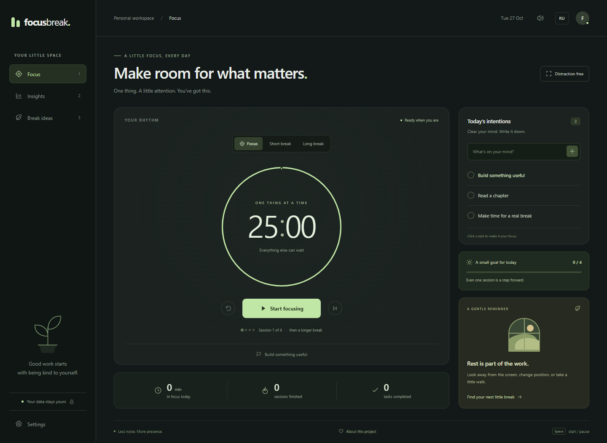

# focusbreak.

**Одно дело. Немного внимания. Время для отдыха.**

Спокойный таймер для работы и перерывов: список задач, статистика и идеи для отдыха. Бесплатно, с открытым исходным кодом.

[English README](README.md)



## Для чего

Когда работаешь за компьютером, легко провести несколько часов среди вкладок и забыть про отдых. Focus Break помогает выбрать одно дело, спокойно поработать и вовремя отойти от экрана.

Без регистрации, подписки и гонки за рекордами.

## Возможности

- Таймер фокуса: по умолчанию 25 минут работы, 5 минут отдыха и длинный перерыв после четырёх завершённых сессий.
- Настройка длительности всех режимов и небольшой цели на день.
- Список задач с выбором текущего дела.
- Статистика за сегодня, график за неделю и история последних сессий.
- Режим без отвлечений и горячие клавиши.
- Идеи для отдыха от компьютера со ссылками на рекомендации.
- Работа без интернета после первого успешного посещения.
- Сохранение в браузере, скачивание резервной копии и восстановление из JSON.
- Русский и английский интерфейс, адаптация к телефону и поддержка клавиатуры.

Приложение не загружает сторонние шрифты, не содержит аналитики и не отправляет задачи на сервер. Зависимости нужны только для разработки и тестов.

## Запустить

Нужен [Node.js](https://nodejs.org/) версии 22 или новее. Из папки проекта:

```powershell
npm start
```

Открой **http://127.0.0.1:4173**. Для обычного запуска установка пакетов не требуется. В Windows можно запустить `start-focus-break.cmd`.

Также можно разместить содержимое `dist/` на любом статическом HTTPS-хостинге. Открытие HTML двойным кликом не подходит: приложение использует JavaScript-модули.

## Что важно знать о таймере

Таймер сверяется с реальным временем. Переключение вкладки не замедляет отсчёт. Пауза и перезагрузка сохраняют оставшееся время. Завершённая рабочая сессия учитывается один раз; следующий этап ожидает ручного запуска.

Если компьютер спит или браузер закрыт, звуковой сигнал не гарантируется. При возвращении приложение сохранит одну завершённую сессию. Пропуски и сброс таймера не добавляют минуты в статистику. Изменение длительности не влияет на уже начатый таймер.

Данные хранятся в этом браузере и относятся к адресу приложения. Перед сменой устройства или адреса скачай резервную копию: **Статистика → Скачать данные**. Восстановление находится в настройках. Очистка данных браузера может удалить историю. Файл резервной копии содержит текст задач.

Хранятся до 100 задач, 2 000 рабочих сессий и 2 000 записей о выполненных задачах. Очистка готовых задач не сбрасывает их дневной счётчик. Дни определяются по часовому поясу устройства.

## Горячие клавиши

| Клавиша | Действие |
| --- | --- |
| Пробел | Старт / пауза |
| 1 / 2 / 3 | Фокус / статистика / идеи для отдыха |
| Escape | Выйти из режима без отвлечений или закрыть диалог |

Горячие клавиши не мешают вводу текста.

## Проверки

```powershell
npm ci
npm run check
npm test
npx playwright install chromium
npm run test:e2e
```

Для установленного Microsoft Edge в Windows:

```powershell
$env:PLAYWRIGHT_CHANNEL = 'msedge'
npm run test:e2e
```

13 тестов логики и 8 браузерных сценариев проверяют таймер, восстановление после сна, две вкладки, резервные копии, офлайн-работу, мобильную раскладку и доступность. Автоматическая проверка доступности не заменяет ручную.

## Публикация на GitHub Pages

1. В репозитории открой **Settings → Pages**, выбери **GitHub Actions**.
2. Открой **Actions → Publish to GitHub Pages → Run workflow**.
3. После завершения открой ссылку из результата. Для новых изменений запусти этот процесс ещё раз.

Сборка, ключи API и база данных не нужны.

## Участие

Подробности в [CONTRIBUTING.md](CONTRIBUTING.md). Полезные первые задачи: новый перевод, проверка клавиатурой или тестирование со скринридером.

Идеи перерывов основаны на рекомендациях [OSHA о работе за компьютером](https://www.osha.gov/etools/computer-workstations/work-process) и [отдыхе для глаз](https://www.osha.gov/etools/computer-workstations/components/monitors/). Длительность таймеров — настраиваемые значения приложения.

Лицензия [MIT](LICENSE).
