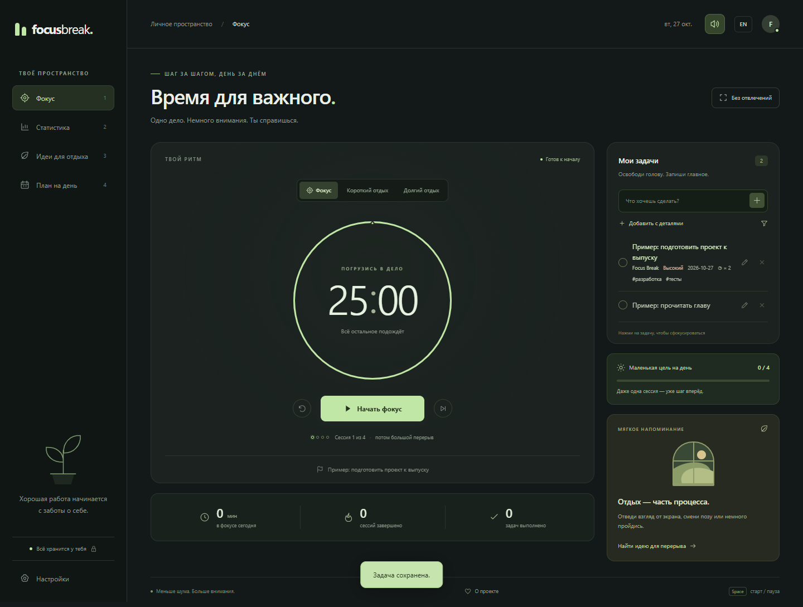

# focusbreak.

**Одно дело. Немного внимания. Время для отдыха.**

Спокойный таймер для работы и перерывов: список задач, статистика и идеи для отдыха. Бесплатно, с открытым исходным кодом.

[English README](README.md)



**Статус:** существующий проект развивается в офлайн-приложение для Windows и Android. Windows-пакеты собираются локально; нативная проверка установки, обновления и жизненного цикла ещё не завершена. Проверенного APK пока нет. Точные статусы: [FEATURES.md](FEATURES.md), план: [ROADMAP.md](ROADMAP.md).

## Для чего

Когда работаешь за компьютером, легко провести несколько часов среди вкладок и забыть про отдых. Focus Break помогает выбрать одно дело, спокойно поработать и вовремя отойти от экрана.

Без регистрации, подписки и гонки за рекордами.

## Возможности

- Таймер фокуса: по умолчанию 25 минут работы, 5 минут отдыха и длинный перерыв после четырёх завершённых сессий.
- Настройка длительности всех режимов и небольшой цели на день.
- Задачи с проектами, тегами, приоритетом, датой срока, повторением после выполнения и поиском.
- План на день и ежедневные заметки.
- Локальная корзина: поиск, восстановление одной / всех задач и быстрая отмена удаления.
- Статистика за сегодня, график за неделю и история последних сессий.
- Режим без отвлечений и горячие клавиши.
- Идеи для отдыха от компьютера со ссылками на рекомендации.
- Работа без интернета после первого успешного посещения.
- Хранилище платформы, проверяемый JSON, контрольная сумма, последняя исправная копия и явное восстановление после повреждения.
- Русский и английский интерфейс, адаптация к телефону и поддержка клавиатуры.

Общий интерфейс использует JavaScript и Vite, Windows-оболочка — Electron, Android — Capacitor. Основные функции не требуют сервера, регистрации или внешнего API. Приложение не загружает сторонние шрифты и не отправляет задачи в аналитику.

## Запустить

Нужен [Node.js](https://nodejs.org/) версии 22 или новее. Из папки проекта:

```powershell
npm ci
npm run build
npm start
```

`npm start` запускает Electron. Для разработки общего интерфейса используй `npm run web`.

Для просмотра собранного интерфейса в браузере выполни `npm run preview` и открой **http://127.0.0.1:4173**. После изменения исходников нужна новая сборка. Браузерные данные хранятся отдельно от Windows-приложения. `start-focus-break.cmd` запускает такой браузерный просмотр существующего `dist/`.

Windows-пакеты: `npm run build:windows`, результат в `release/`. Это локальные неподписанные кандидаты, требующие нативной проверки. Новый Portable выбирает папку `Focus Break Data` рядом с внешним EXE. Переносятся EXE и вся папка вместе, после полного выхода. Ранние кандидаты использовали профиль Windows; инструкция перехода и ограничения проверок — в [PORTABLE.md](PORTABLE.md).

Android: `npm run android:sync` синхронизирует общий интерфейс с существующим проектом. `android:apk` пока ссылается на отсутствующий скрипт; готовый APK не заявлен.

Также можно разместить содержимое `dist/` на любом статическом HTTPS-хостинге. Открытие HTML двойным кликом не подходит: приложение использует JavaScript-модули.

## Что важно знать о таймере

Таймер сверяется с реальным временем. Переключение вкладки не замедляет отсчёт. Пауза и перезагрузка сохраняют оставшееся время. Завершённая рабочая сессия учитывается один раз; следующий этап ожидает ручного запуска.

Если компьютер спит или браузер закрыт, звуковой сигнал не гарантируется. При возвращении приложение сохранит одну завершённую сессию. Пропуски и сброс таймера не добавляют минуты в статистику. Изменение длительности не влияет на уже начатый таймер.

Windows хранит данные в Electron userData, Android использует Preferences, браузер — localStorage своего адреса. Перед сменой устройства, адреса или версии скачай резервную копию: **Статистика → Скачать данные**. Восстановление находится в настройках. Копия включает корзину и текст задач. Подробности: [STORAGE.md](STORAGE.md).

Коллекции больше не обрезаются незаметно. Текущий лимит документа — 5 МБ UTF-8; слишком большой импорт отклоняется целиком. «Убрать готовые» переносит задачи в корзину и сохраняет дневной счётчик. Дни определяются по часовому поясу устройства.

Очистка данных браузера может удалить записи. Сброс рабочих данных сохраняет локальные копии для восстановления и прямо предупреждает, что это не полное удаление персональных данных. Управление копиями и окончательное удаление из корзины ещё предстоит добавить.

## Горячие клавиши

| Клавиша | Действие |
| --- | --- |
| Пробел | Старт / пауза |
| 1 / 2 / 3 / 4 | Фокус / статистика / идеи для отдыха / план на день |
| Escape | Выйти из режима без отвлечений или закрыть диалог |

Горячие клавиши не мешают вводу текста.

## Проверки

```powershell
npm ci
npm run check
npm test
npm run build
npx playwright install chromium
npm run test:e2e
```

Для установленного Microsoft Edge в Windows:

```powershell
$env:PLAYWRIGHT_CHANNEL = 'msedge'
npm run test:e2e
```

55 тестов логики / хранения и 24 браузерных сценария проверяют таймер, корзину, выбор каталога, перенос файлов, резервные копии, отказ записи, офлайн-работу, две вкладки и доступность. Четыре сценария desktop-настроек используют имитацию preload API. Эти проверки не заменяют нативную приёмку Electron и Android. CI теперь собирает Vite перед browser tests; удалённый запуск текущей версии ещё не выполнен.

## Сборка и публикация

Исходники находятся в `src/`, `shared/`, `desktop/`, `android/`. Каталог `dist/` и версия офлайн-кэша генерируются сборкой; вручную их редактировать не нужно. Старый workflow Pages ещё требует проверки под текущую структуру. Push, развёртывание и публичный release выполняются только после отдельного разрешения владельца. Номер версии пакета сам по себе не означает стабильный выпуск.

## Участие

Подробности в [CONTRIBUTING.md](CONTRIBUTING.md). Полезные первые задачи: новый перевод, проверка клавиатурой или тестирование со скринридером.

Идеи перерывов основаны на рекомендациях [OSHA о работе за компьютером](https://www.osha.gov/etools/computer-workstations/work-process) и [отдыхе для глаз](https://www.osha.gov/etools/computer-workstations/components/monitors/). Длительность таймеров — настраиваемые значения приложения.

В репозитории уже находится [MIT](LICENSE). Владелец запросил отдельное подтверждение окончательной лицензии перед первым публичным нативным выпуском; файл лицензии в этой работе не изменяется.
